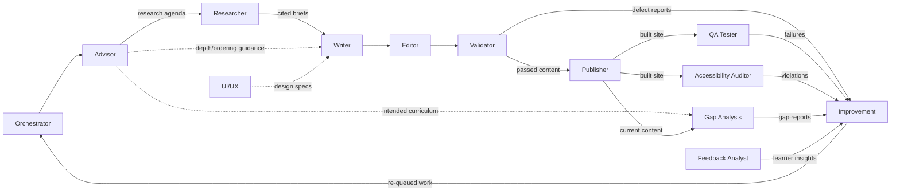

# Programming Tutorial

A website to teach people how to do programming, built and maintained by a multi-agent pipeline. Each agent has a single, well-defined scope; together they take a curriculum goal all the way to a validated, published, accessible site — and keep improving it from learner feedback.

## The Agent Pipeline

**How to read the flow:** the Orchestrator dispatches to the Advisor, which owns curriculum authority and sets the research agenda *first*; the Researcher then executes that agenda (no blind research) and feeds cited briefs to the Writer, alongside UI/UX design specs and Advisor guidance. Content moves Writer → Editor → Validator, and only *passed* content reaches the Publisher. The built site is tested in parallel by the QA Tester and the Accessibility Auditor. Gap Analysis compares published content against the Advisor's intended curriculum. Every finding — defects, failures, violations, gaps, learner insights — converges on Improvement, which re-queues work through the Orchestrator, closing the loop.

## Agents

### Core pipeline

| Agent | Scope (one line) | Document |
|---|---|---|
| **Orchestrator** | Owns the pipeline: decomposes goals, dispatches work to every agent, tracks state, resolves blockers. | [agents/orchestrator.md](agents/orchestrator.md) |
| **Advisor** | Domain & curriculum authority: designs the learning path and sets the research agenda *before* research begins. | [agents/advisor.md](agents/advisor.md) |
| **Researcher** | Executes the Advisor's research agenda; produces cited, dated research briefs on approved topics. | [agents/researcher.md](agents/researcher.md) |
| **UI/UX** | Designs the learning experience: page templates, code-block presentation, navigation, visual system, responsive rules. | [agents/ui-ux.md](agents/ui-ux.md) |
| **Writer** | Authors lessons: explanations, complete runnable code samples, worked examples, exercises. | [agents/writer.md](agents/writer.md) |
| **Validator** | Verifies content correctness — runs code, fact-checks claims, checks pedagogy; returns pass/fail with defect reports. | [agents/validator.md](agents/validator.md) |
| **Gap Analysis** | Compares the intended curriculum against existing/published content; reports missing topics, broken prerequisites, coverage holes. | [agents/gap-analysis.md](agents/gap-analysis.md) |
| **Improvement** | Consumes all findings (defects, gaps, failures, violations, insights), prioritizes them, and re-queues work through the Orchestrator. | [agents/improvement.md](agents/improvement.md) |

### Recommended extras

| Agent | Scope (one line) | Document |
|---|---|---|
| **Editor** | Tone & readability pass between Writer and Validator: voice consistency, plain language, style-guide enforcement. | [agents/editor.md](agents/editor.md) |
| **Publisher** | Builds and ships the site: build pipeline, CI/CD, deployments, versioning; only agent that can put content in front of learners. | [agents/publisher.md](agents/publisher.md) |
| **QA Tester** | Site-level testing on built artifacts: rendering, links, exercise interactivity, responsive behavior — distinct from the Validator's content-correctness role. | [agents/qa-tester.md](agents/qa-tester.md) |
| **Accessibility Auditor** | WCAG compliance of the site: keyboard nav, screen-reader flow, contrast, ARIA; reports violations with severity and fixes. | [agents/accessibility-auditor.md](agents/accessibility-auditor.md) |
| **Feedback Analyst** | Learner feedback loop: analyzes confusion points, drop-off, and exercise failure rates into structured insights for Improvement. | [agents/feedback-analyst.md](agents/feedback-analyst.md) |

### Key boundaries (where agents must not overlap)

- **Validator vs QA Tester** — the Validator checks *content correctness* in source form (does the code run, are the facts right); the QA Tester checks *site behavior* on built artifacts (does the page render, do links resolve).
- **Gap Analysis vs Improvement** — Gap Analysis only *finds and reports* coverage holes; Improvement *acts* by prioritizing and re-queueing work. Neither writes content.
- **Advisor vs Researcher** — the Advisor decides *what* to research (agenda); the Researcher *executes* it. No research happens without an agenda.
- **Editor vs Writer** — the Writer produces complete drafts; the Editor polishes prose and never changes technical facts.

## Adding a new agent

1. Create `agents/<name>.md` using the same template as the existing docs: Mission, Inputs, Responsibilities / In-scope, Outputs / Deliverables, Interfaces, Quality Criteria & Guardrails, Out of Scope.
2. Add it to the pipeline diagram above where it fits.
3. Add a row to the index table in this README.

*(An SEO Specialist was considered for future work but is not yet part of the pipeline.)*
